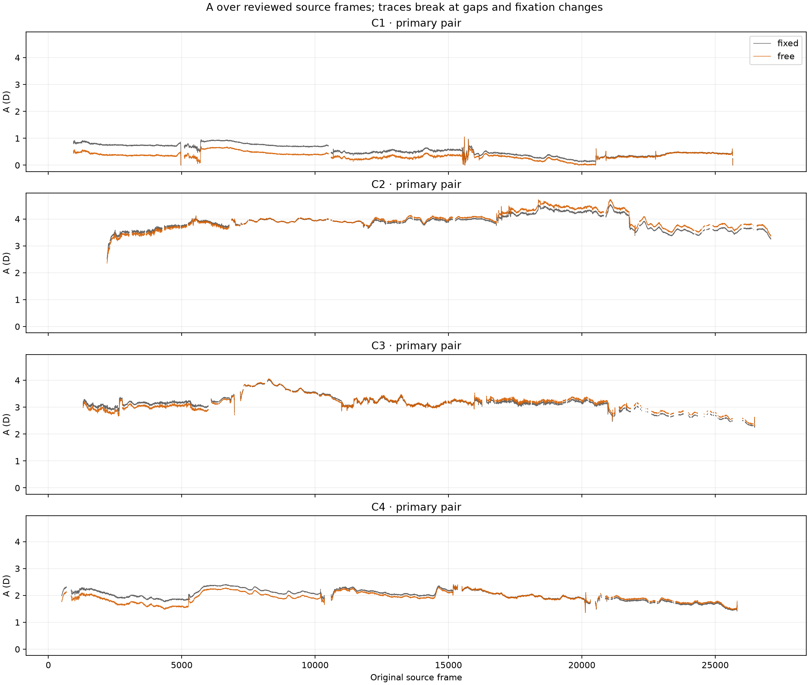
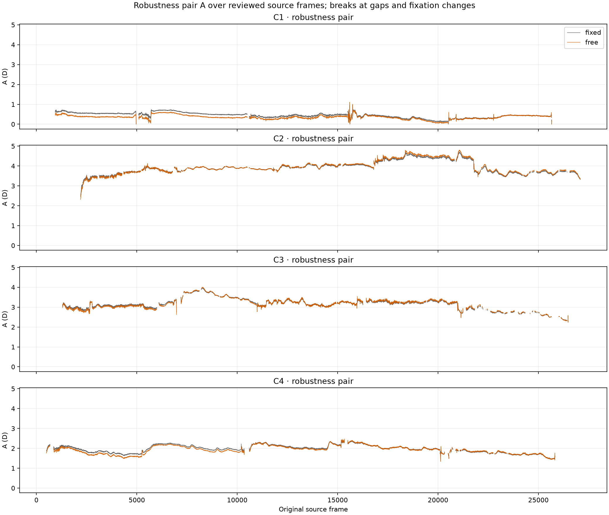
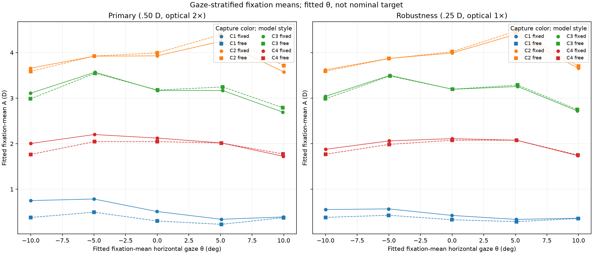
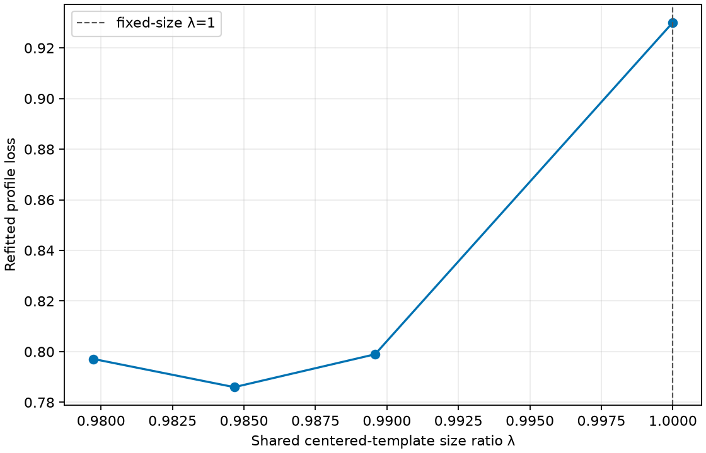

# Free-size comparison artifact index

The scientific findings, paired results, gaze-associated A pattern, cell regressions, profile interpretation and limitations are consolidated in the [canonical experiment record](../../RECORD.md) and [current status](../../../CURRENT_STATUS.md). This file indexes the supporting report artifacts; it intentionally does not duplicate the findings tables.

## Figures

All plots use reviewed fixation rows and preserve source-frame gaps; there is no post-fit residual filtering.

## Derived tables

- [Capture/fixation held-cell changes](held_cell_changes.csv)
- [Fixation metrics](fixation_metrics.csv)
- [Anchor-setting stability](anchor_setting_stability.csv)
- [Primary profile points](primary_size_profile.csv)

## Fit artifacts and audit

- [Production free-size fits](../results/production/)
- [Training fits](../results/training/)
- [Fixed-size paired controls](../inputs/fixed_controls/)
- [Held validation](../validation/temporal/)
- [Profile arrays and summary](../validation/template_size_profile/free_size_sigma050_optical2/)
- [Independent audit narrative](../audits/AUDIT.md)
- [Machine-readable independent audit](../audits/free_size_output_audit.json)
- [Audit manifest](../audits/MANIFEST.json)
- [Frozen run plan and imports](../provenance/)

To rebuild plots from the saved arrays and refresh retained derived tables, use [`scripts/report_free_size.py`](../scripts/report_free_size.py). The merged fixation table, profile points and held-cell audit are retained as canonical report inputs. Exact fit-time sources are preserved under [frozen sources](../provenance/frozen_sources/); duplicate snapshots and intermediate tables are archived.
