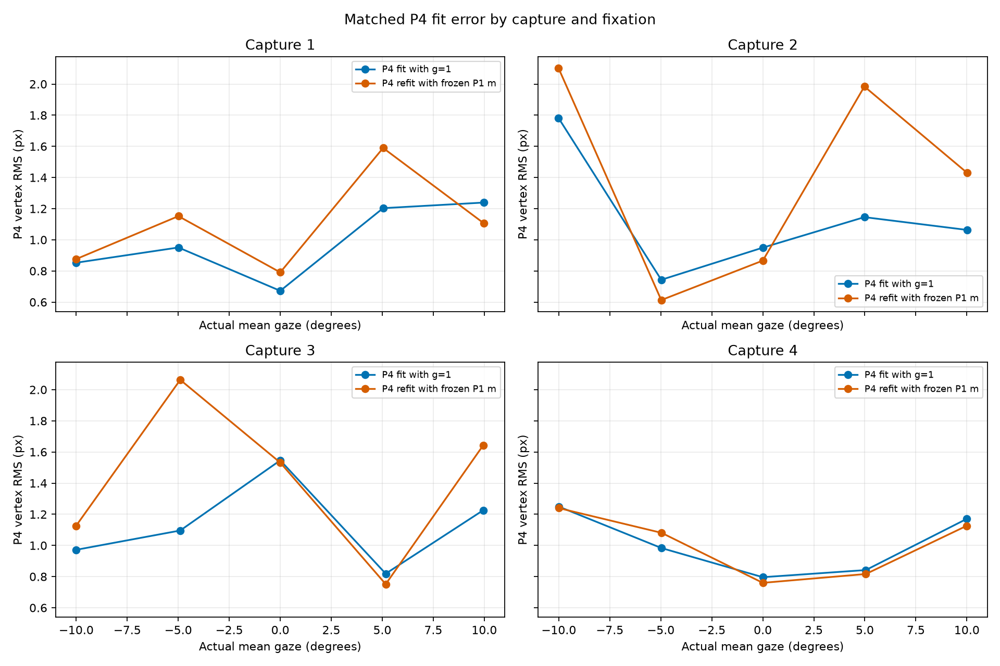
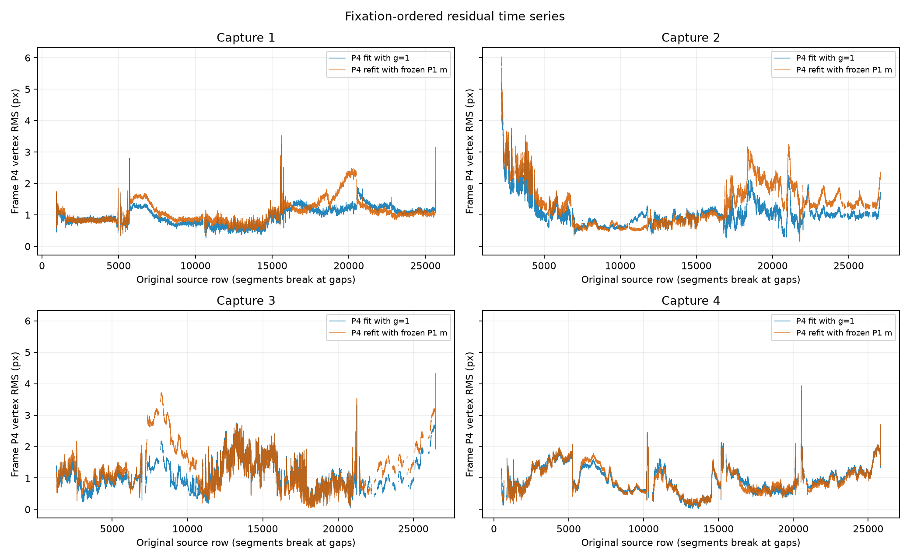
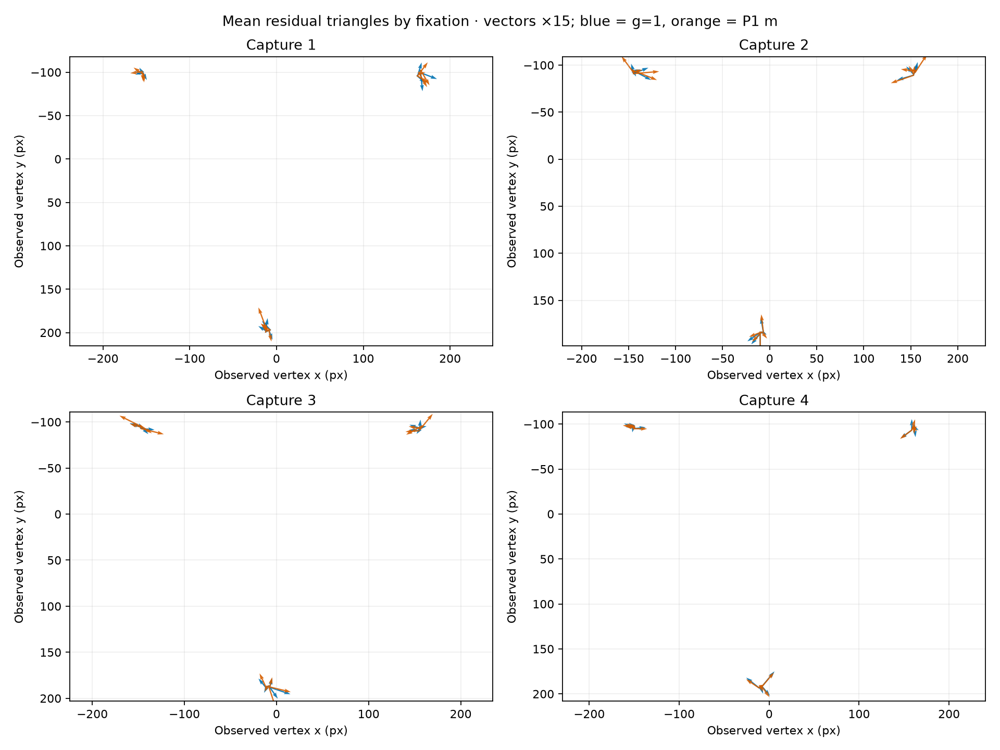
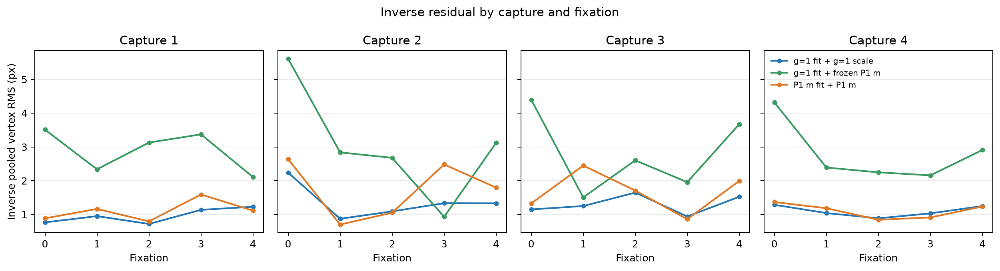
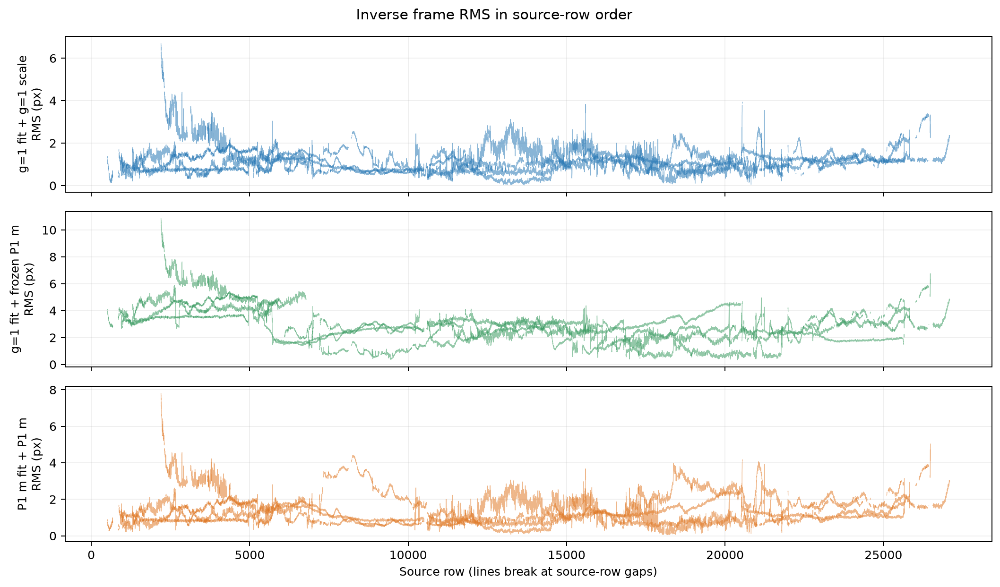

# P1-derived scale effect on a fully refit P4 geometry model

> **Question:** Does applying the frozen P1-derived per-frame scale improve the P4 geometric fit after refitting the complete P4 model?

## Matched comparison

Both branches use the same 88,978-row P4-filtered cohort, saved gaze, capture/fixation labels, C1 nominal-zero empirical P4 reference, optimizer protocol, and capture/fixation weighting. The baseline sets the P4 input scale to `g=1`; the comparison uses the frozen P1-derived `m` and refits all P4 parameters. This is a whole-model conditional geometry comparison.

| Capture | Nominal A label (D) | g=1 P4 RMS (px) | P1-m P4 RMS (px) | Δ P1-m−g1 (px) | Δ (%) |
|---:|---:|---:|---:|---:|---:|
| 1 | 0.36036 | 1.00666 | 1.1375 | 0.130844 | 13 |
| 2 | 4 | 1.18925 | 1.51828 | 0.329024 | 27.7 |
| 3 | 3 | 1.15835 | 1.4921 | 0.333746 | 28.8 |
| 4 | 2 | 1.02366 | 1.02145 | -0.00221735 | -0.217 |

The equal-capture/equal-fixation objective is `1.20433929 px²` at `g=1` and `1.71719835 px²` with P1 `m` (0.51285906 px²; 42.58%). The square root is the corresponding weighted vertex RMS, not row-pooled RMS.

### Matched fixation changes

Positive Δ means the P1-m refit has larger residual RMS at the same capture and target fixation.

| Capture | Target (°) | Actual mean gaze (°) | g=1 RMS (px) | P1-m RMS (px) | Δ (px) | Δ (%) |
|---|---|---|---|---|---|---|
| 1 | -10 | -9.9982 | 0.852989 | 0.876589 | 0.0235995 | 2.767 |
| 1 | -5 | -4.9915 | 0.950695 | 1.15192 | 0.201221 | 21.17 |
| 1 | 0 | 1.6983e-05 | 0.672451 | 0.791015 | 0.118564 | 17.63 |
| 1 | 5 | 5.0407 | 1.20316 | 1.58962 | 0.38646 | 32.12 |
| 1 | 10 | 9.9856 | 1.2392 | 1.10528 | -0.133919 | -10.81 |
| 2 | -10 | -10.012 | 1.78165 | 2.10169 | 0.320039 | 17.96 |
| 2 | -5 | -4.9777 | 0.743206 | 0.613093 | -0.130114 | -17.51 |
| 2 | 0 | -0.00016815 | 0.94967 | 0.866455 | -0.0832154 | -8.763 |
| 2 | 5 | 4.9778 | 1.14555 | 1.98411 | 0.838564 | 73.2 |
| 2 | 10 | 10.011 | 1.06341 | 1.43018 | 0.366772 | 34.49 |
| 3 | -10 | -10.014 | 0.971615 | 1.12474 | 0.153124 | 15.76 |
| 3 | -5 | -4.9024 | 1.09585 | 2.0632 | 0.967352 | 88.27 |
| 3 | 0 | -0.00048255 | 1.5462 | 1.53171 | -0.0144955 | -0.9375 |
| 3 | 5 | 5.1679 | 0.818788 | 0.751453 | -0.0673355 | -8.224 |
| 3 | 10 | 9.9463 | 1.22589 | 1.6429 | 0.417009 | 34.02 |
| 4 | -10 | -10.008 | 1.24968 | 1.23988 | -0.0098005 | -0.7842 |
| 4 | -5 | -4.9621 | 0.98296 | 1.08088 | 0.0979154 | 9.961 |
| 4 | 0 | -0.0001973 | 0.796156 | 0.759854 | -0.0363012 | -4.56 |
| 4 | 5 | 5.0498 | 0.841979 | 0.816598 | -0.025381 | -3.014 |
| 4 | 10 | 9.9856 | 1.16993 | 1.12559 | -0.0443361 | -3.79 |




Fixation points are matched by capture and actual saved gaze. These are descriptive in-cohort residuals; they are not independent validation.



Lines follow original source-row order and break at missing-row gaps. Residual variability therefore retains temporal dependence and fixation ordering.



Arrows show per-vertex mean residuals at the mean observed vertex locations, grouped by fixation (blue = `g=1`; orange = P1 `m`). Vectors are magnified 15× for legibility; they visualize structured residual direction and are not an independent test.

## Fitted parameters and fit diagnostics

### Fit convergence

| Fit | Objective (px²) | √objective (px) | Selected stationary | Stationary starts | Scaled gradient |
|---|---|---|---|---|---|
| baseline_g1 | 1.20433929 | 1.097424 | True | 7/8 | 8.77e-08 |
| p1m | 1.71719835 | 1.310419 | True | 8/8 | 6.77e-07 |

`baseline_g1` selected checkpoint: stationary=`True`, reason=`projected_gradient`, near-best stationary starts `7/8`, scaled gradient `8.77e-08`.
`p1m` selected checkpoint: stationary=`True`, reason=`projected_gradient`, near-best stationary starts `8/8`, scaled gradient `6.77e-07`.

### Domain checks

| Fit | All rows valid | Invalid rows | Minimum projective denominator | Minimum radial factor | Minimum radial derivative | Max |stretch exponent| | Minimum domain margin |
|---|---|---|---|---|---|---|---|
| baseline_g1 | True | 0 | 0.879175 | 0.932007 | 0.796021 | 0.030108 | 0.796021 |
| p1m | True | 0 | 0.947294 | 0.926886 | 0.780659 | 0.0023907 | 0.780659 |

### Fitted geometry and nuisance parameters

| Fit | Capture | Nominal A label (D) | Parameter | Value | Unit |
|---|---|---|---|---|---|
| baseline_g1 | all | — | b | 0.0009724401 | dimensionless |
| baseline_g1 | all | — | cx | -0.029535 | dimensionless |
| baseline_g1 | all | — | cy | -0.0215152 | dimensionless |
| baseline_g1 | all | — | theta04_deg | -44.88615 | degrees |
| baseline_g1 | all | — | B_v1_x_px | 160.5968 | pixels |
| baseline_g1 | all | — | B_v1_y_px | -84.306 | pixels |
| baseline_g1 | all | — | B_v2_x_px | 1.847695 | pixels |
| baseline_g1 | all | — | B_v2_y_px | 191.0701 | pixels |
| baseline_g1 | all | — | B_v3_x_px | -162.4445 | pixels |
| baseline_g1 | all | — | B_v3_y_px | -106.7641 | pixels |
| baseline_g1 | 1 | 0.36036 | kappa_capture1_px_inv2 | 0 | px^-2 |
| baseline_g1 | 1 | 0.36036 | beta_capture1 | 0 | dimensionless |
| baseline_g1 | 2 | 4 | kappa_capture2_px_inv2 | -1.799386e-06 | px^-2 |
| baseline_g1 | 2 | 4 | beta_capture2 | -0.06581819 | dimensionless |
| baseline_g1 | 3 | 3 | kappa_capture3_px_inv2 | -1.390446e-06 | px^-2 |
| baseline_g1 | 3 | 3 | beta_capture3 | -0.05085993 | dimensionless |
| baseline_g1 | 4 | 2 | kappa_capture4_px_inv2 | -7.988047e-07 | px^-2 |
| baseline_g1 | 4 | 2 | beta_capture4 | -0.0292188 | dimensionless |
| p1m | all | — | b | -0.0004418238 | dimensionless |
| p1m | all | — | cx | -0.02771734 | dimensionless |
| p1m | all | — | cy | -0.002130358 | dimensionless |
| p1m | all | — | theta04_deg | -12.50435 | degrees |
| p1m | all | — | B_v1_x_px | 164.9078 | pixels |
| p1m | all | — | B_v1_y_px | -96.6829 | pixels |
| p1m | all | — | B_v2_x_px | -6.94232 | pixels |
| p1m | all | — | B_v2_y_px | 200.2054 | pixels |
| p1m | all | — | B_v3_x_px | -157.9655 | pixels |
| p1m | all | — | B_v3_y_px | -103.5225 | pixels |
| p1m | 1 | 0.36036 | kappa_capture1_px_inv2 | 0 | px^-2 |
| p1m | 1 | 0.36036 | beta_capture1 | 0 | dimensionless |
| p1m | 2 | 4 | kappa_capture2_px_inv2 | -1.8219e-06 | px^-2 |
| p1m | 2 | 4 | beta_capture2 | -0.06664173 | dimensionless |
| p1m | 3 | 3 | kappa_capture3_px_inv2 | -1.414595e-06 | px^-2 |
| p1m | 3 | 3 | beta_capture3 | -0.05174326 | dimensionless |
| p1m | 4 | 2 | kappa_capture4_px_inv2 | -8.02701e-07 | px^-2 |
| p1m | 4 | 2 | beta_capture4 | -0.02936132 | dimensionless |

The model fits shared keystone parameters (`b`, `cx`, `cy`), one free P4 nuisance gaze offset `θ04`, a shared P4 reference triangle, and capture-specific radial coefficients. C1 `k=0` sets the radial reference gauge. The nominal A column is a capture label, not a fitted accommodation state. `θ04` is expressed in the saved gaze coordinate and has no absolute physical-angle meaning.

| Fit | Selected stationary | Scaled gradient | Sensitivity scaled gradient | Active bounds |
|---|---|---|---|---|
| baseline_g1 | True | 8.77e-08 | 2.04e-09 | none |
| p1m | True | 6.77e-07 | 1.88e-08 | none |

## P1 scale provenance and limits

| Source artifact | Array key | P1 model | Fit scope | m bounds | Minimum m | Mean m | Maximum m | P1 fit stationary |
|---|---|---|---|---|---|---|---|---|
| experiments/reverse_transform/p4_gaze_accommodation_decoupling/stage_00_baseline_sensitivity/p1_joint_bounded_magnification/results/arrays.npz | frozen_learned_primary_m | m_pm_2pct_learned_all | C1 all rows | [0.98, 1.02] | 0.98 | 0.9878619 | 0.9993325 | True |

P1 calibration gauge: `sum(B**2)=sum(initial_reference**2); centroid(B)=0 is the fixed coordinate-origin convention; no mean-log(m) constraint`. Rows were joined exactly by `(capture, source_row)` with fixation and saved gaze also checked. Source and array hashes are retained in `summary.json`.

Across the cohort, frozen `m` has mean `0.9878619` and `0.7721%` of rows sit at the 0.98 floor. In C1 its fixation means are `0.9818754` at +5° and `0.992378` at +10°; about 11% of the +5° C1 rows are at the floor. This gaze-associated pattern could interact with the fitted P4 nuisance offset, but gaze and fixation sequence are confounded and the pattern is not causal evidence.

The P1 scale is measured from P1 geometry under its own empirical reference and calibration gauge, then held fixed while P4 is completely refit. Here P1-m increases equal-weight P4 loss overall, chiefly in C1–C3, while C4 is nearly unchanged. This P1 scale does not improve this P4 fit under the stated model. The large shift in fitted `θ04` indicates nuisance gaze/scale/template tradeoff; gaze-correlated P1 scale can leak into this parameter. Capture and nominal accommodative demand remain confounded, and fixation sequence and saved gaze remain conditional inputs. The comparison does not identify the physical cause of the residuals.

This stage does not estimate or identify accommodation. The scale-to-accommodation effect cannot yet be quantified without fitting and validating `k(A)` together with accommodation `A`. No physiological or optical-zero inference follows from this comparison.

## Inverse distortion using the declared frame scale

The inverse diagnostic centers measured P4, uses the branch frame scale, restores its fitted raw optical mean, then reverses stretch, projective keystone, and capture barrel distortion. Recovered vertices are compared with the relevant fitted native B4. This row-pooled in-sample metric is separate from the equal-capture/equal-fixation forward objective.

Three branches distinguish direct scale substitution from full recalibration. The frozen-scale-only branch retains the baseline `g=1` P4 parameters/template and substitutes P1 `m` only in the inverse; since the frozen scale mean is 0.987862, a mismatch under fixed geometry is expected. The full P1-m branch refits P4 and is the appropriate matched model comparison.

| Inverse branch | Pooled RMS (px) | Template-radius RMS (%) | Valid / frames | Invalid |
|---|---:|---:|---:|---:|
| g=1 fit and scale | 1.21121 | 0.64075 | 88978 / 88978 | 0 |
| fixed g=1 fit with P1 m substituted | 3.01235 | 1.5936 | 88978 / 88978 | 0 |
| full P1-m P4 refit | 1.48594 | 0.76788 | 88978 / 88978 | 0 |

Capture pooled inverse RMS (px):

| Capture | g=1 fit/scale | Fixed fit + P1 m scale | Full P1-m refit |
|---:|---:|---:|---:|
| 1 | 0.989315 | 2.92852 | 1.15168 |
| 2 | 1.42407 | 3.28362 | 1.88249 |
| 3 | 1.31628 | 2.9824 | 1.70814 |
| 4 | 1.10259 | 2.8499 | 1.11749 |

The fixed-geometry substitution is a scale-mismatch diagnostic, not evidence about the outcome of refitting. The full P1-m refit remains the comparison of interest; its inverse RMS is 22.68% above `g=1`. These are in-sample diagnostics, not independent validation or physical scale/accommodation estimates.





## Reproduction

From the repository root, regenerate the forward fit outputs, inverse diagnostics, report text, and inverse figures in this order:

```bash
python experiments/reverse_transform/p4_gaze_accommodation_decoupling/stage_00_baseline_sensitivity/p4_p1_scale_effect/run.py
python experiments/reverse_transform/p4_gaze_accommodation_decoupling/stage_00_baseline_sensitivity/p4_p1_scale_effect/inverse_effect.py
python experiments/reverse_transform/p4_gaze_accommodation_decoupling/stage_00_baseline_sensitivity/p4_p1_scale_effect/report.py
python experiments/reverse_transform/p4_gaze_accommodation_decoupling/stage_00_baseline_sensitivity/p4_p1_scale_effect/inverse_plot.py
```
